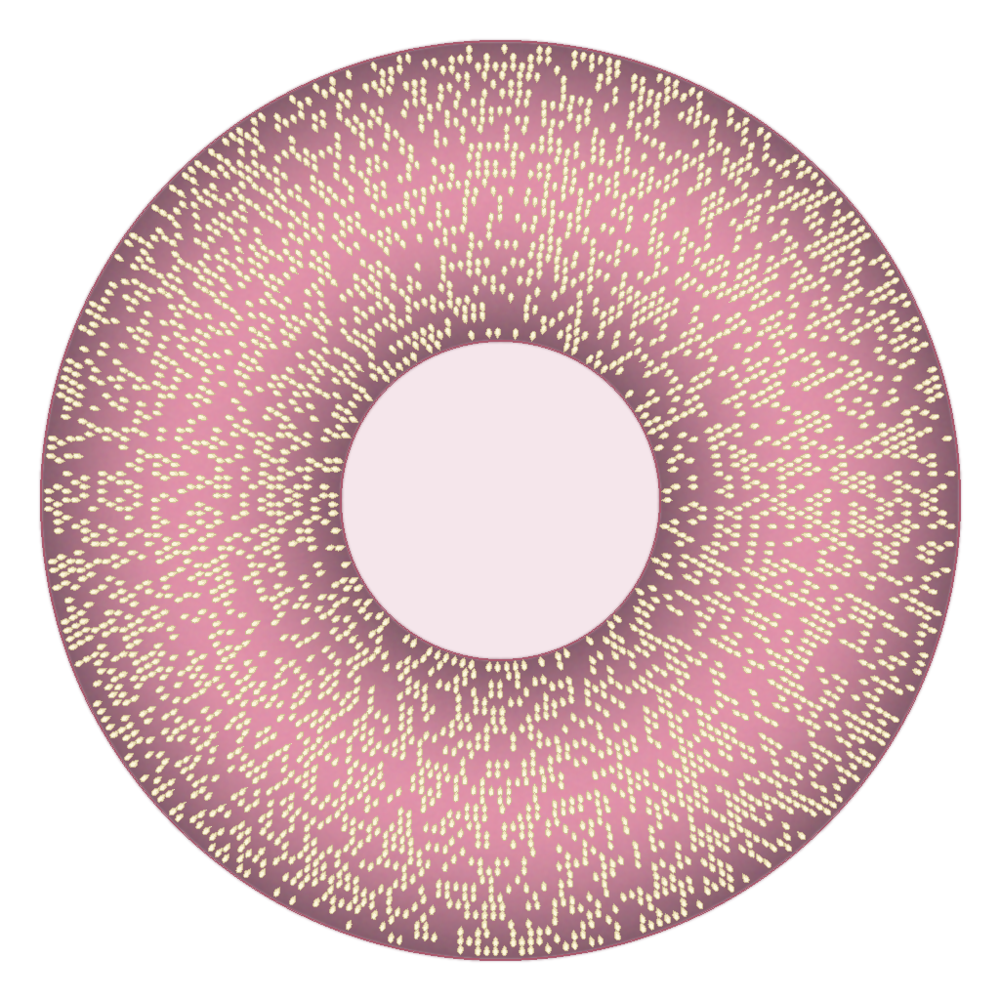
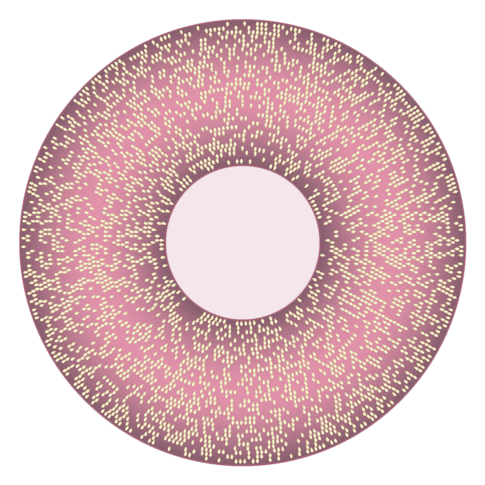
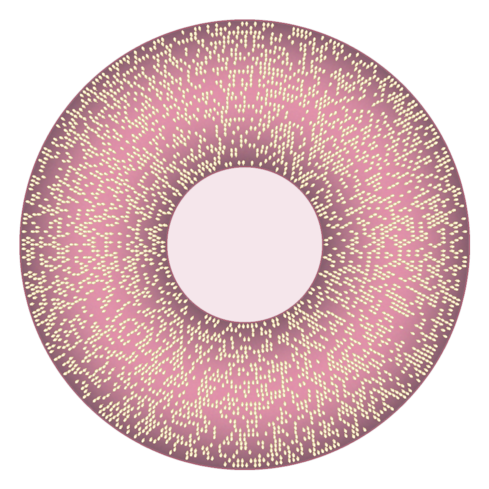

# 芝码 · Spiral Sesame Code

> 一种把链接藏在**贝果上的白芝麻**里的圆形二维码。为《异环》玩家分享 B 站 / 小红书链接而做的同人小项目。

在线体验：**https://steventaoe.github.io/nte-sesame-code/**

| 生成 | 扫描 |
| --- | --- |
| 输入链接 → 自动识别平台 → 一键下载芝码图 | 拖入 / 上传芝码图 → 解出链接 → 一键跳转 |

全部计算在浏览器本地完成（Canvas + 纯 JS 实现的 Reed–Solomon 与 SHA-256），不上传任何数据，不消耗服务器资源。

---

## 关于《异环》

《异环》（*Neverness to Everness*）是 **Hotta Studio**（完美世界旗下，运营主体为苏州幻塔网络科技有限公司）自主研发的**超自然都市开放世界 RPG**，登陆 Android / iOS / PC 平台，已于 2026 年 4 月 23 日公测。

故事从**海特洛市**开始。这是一座日常与超自然交织的大都市：玩家作为首位"无证上岗"的**异象猎人 / 异象鉴定师**，加入古董店「伊波恩」，接受各种**异象委托**，与伙伴一起调查并解决城市中突发的异常事件。在战斗之外，游戏提供了完整的都市生活循环——**经营店铺赚取资金、买车买房、改装跑车、自由装扮**，用自己喜欢的方式体验一座活着的海特洛市。

芝码正是在这个语境下诞生的：一张粉色贝果 + 一圈白芝麻，看起来像是游戏周边里会卖的东西，实际上里面能装下一条完整的分享链接。

参考：[TapTap 页面](https://www.taptap.cn/app/714119) · [IGN China](https://www.ign.com.cn/neverness-to-everness) · [官方社区公告](https://douliu.wanmei.com/topic.html?topicId=498)

> 本项目为玩家自制同人作品，与 Hotta Studio / 完美世界无任何官方关联。

---

## 效果展示

| 内容 | 字节数 | 芝码 |
| --- | --- | --- |
| B 站完整视频链接 | 68 B |  |
| 小红书笔记链接 | 96 B |  |
| B 站短链 | 27 B |  |

注意三张图的**芝麻密度几乎一致**——无论装 27 字节还是 96 字节，环面上的 7285 个格位始终全部参与编码（加白后约一半位置有芝麻）。这是刻意设计的：芝码不暴露 payload 长度，也不存在 QR 码那样的定位角标，视觉上就是一块均匀的贝果。

---

## 编码原理（v6：有/无芝麻）

v6 抛弃了 v5 的"黑芝麻 = 0 / 白芝麻 = 1"双色方案，改用更贴近真实贝果的**存在性编码**：

- **`1` = 在该位置放一枚白芝麻，芝麻的"尖"始终指向贝果圆心**（放射状排列，视觉上像真的撒上去的）
- **`0` = 该位置留空**，露出粉色面团

### 流水线

```
文本(UTF-8)
  → 版本号 + 长度元数据(3B)  ┐
  → 'SSM6' + 长度(2B) + 数据 + SHA-256 前 4 字节  ├→ 拼接
  → Reed–Solomon(GF(256), nsym=30) 纠错编码        ┘
  → 补零到 1457 个逻辑位
  → 加白 (XOR LCG 伪随机序列)      ← 让芝麻密度恒定在 ~50%
  → 每位重复 5 次 → 7285 个物理位
  → 扇区交织 (5 份副本落在 5 个互不相邻的 72° 扇区)
  → 极坐标网格渲染到贝果环面
```

### 关键设计

**极坐标网格** — 环面内半径 `inner_r+4` 到外半径 `outer_r-4`，按弧长等距（间距 9px）生成同心圈，奇数圈错位半个角步长，共 **7287 个格位**（1024×1024）。格位数量固定，所以图案密度与数据量无关。

**加白（whitening）** — 逻辑位流与一个由 `LCG(seed=7)` 生成的伪随机 0/1 序列异或。短链接本来会产生大片 `0`（空位），加白后任何 payload 的芝麻覆盖率都稳定在 50% 左右，肉眼无法从密度推断内容长度，也让解码器的判决门限可以固定。

**版本分级（借鉴 QR 码）** — 前 3 字节为固定位置的元数据：`版本号(1B) + 数据长度(2B)`。解码器先读元数据确定数据区范围，再只对该区做 RS 解码。

| 版本 | 最大 payload |
| --- | --- |
| v1 | 30 B（短链，如 `b23.tv/...`） |
| v2 | 70 B（中等链接） |
| v3 | 144 B（完整链接，1024px 上限） |

实际可用容量 **139 字节**（扣除元数据 3B + 头 4B + 长度 2B + 校验 4B + RS 30B）。

**5 重空间重复 + 扇区交织** — 每个逻辑位重复 5 次，并且这 5 份副本被强制分配到 5 个不同的 72° 扇区。任何局部损伤（撕角、遮挡、裁切）最多只吃掉每个位的一两份副本，剩下 3~4 份用多数投票即可还原；若 5 份中有 ≥3 份不可读，该位标记为**擦除（erasure）**。

**擦除感知 RS** — 擦除位置会传给 `RSCodec.decode(erase_pos=...)`。已知位置的擦除只消耗 1 个纠错符号（而非 2 个），因此 30 个校验字节最多可纠正 **30 处已知擦除** 或 **15 处未知错误**，实际远好于纯纠错。

**完整性校验** — payload 附 4 字节 SHA-256 摘要，解码后重新计算比对，杜绝"解出乱码还报成功"。

### 解码鲁棒性

没有定位角标，解码器必须自己找回几何：

1. **圆检测** — 从圆心向外扫描 180 条射线找外缘。要求先出现连续 ≥30px 的暗区，再出现亮跳变，才算真正的饼边；否则白芝麻成排会被误判为轮廓。
2. **种子圈定标** — 若外圈被裁掉（图片被平台裁成方图 / 用户手滑），改用**芝麻圈的径向密度峰**与标准圈半径匹配来恢复缩放比例（粗扫 500–2000，步长 10；再 ±9，步长 2）。
3. **归一化** — 按恢复的中心与缩放，把原图重采样到 1024×1024 标准空间。
4. **破损掩膜** — 从图像边界做纯白连通域泛洪（灰度 ≥250），标记被"撕掉/留白"的区域；与之重叠的亮格判为擦除而非 `1`，避免缺口被误读成芝麻。
5. **读值** — 格内均值 ≥205 → `1`，≤192 → `0`，中间 → 擦除。

实测抗损矩阵（3 条真实链接 × 5 种损伤）：

| 损伤类型 | 结果 |
| --- | --- |
| 无损 | 3/3 ✅ |
| 外圈裁切 8% | 3/3 ✅ |
| 去掉一个象限（25% 面积） | 3/3 ✅ |
| 挖掉 60° 扇形 | 3/3 ✅ |
| 中心区域深色圆遮挡 | 3/3 ✅ |

**15/15 全部解码成功。**

### 相机鲁棒前端

上面那张抗损矩阵针对的是"图已经摆正了"的情形。手机拍出来的照片还要多四个未知量：贝果又小又偏、画面是斜的（圆变椭圆 + 梯形畸变）、面内旋转未知（极坐标网格没有角度基准）、光照任意。所以 Python 解码器另有一条前端，不依赖任何固定亮度阈值：

1. **形态学白顶帽** `a − opening(a, k)` — 只保留比结构元小的亮斑。平滑光照、渐变阴影、木纹背景全部被减掉，剩下的就是芝麻。这一步让解码器对整体亮度、色温、伽马不敏感。
2. **种子盘矩定位** — 顶帽能量图的质心给中心，二阶中心矩给缩放、长宽比和倾斜轴方向。
3. **边缘圆锥拟合** — 逐角度找能量最陡的径向下降点，再对这批点做代数椭圆拟合，得到种子圈外缘的圆锥。
4. **8 自由度位姿模型** — 旋转 φ → 径向梯形畸变 `d = 1 + (kx·qx + ky·qy)/R0` → 各向异性压缩 → 缩放 → 平移。这组参数**恰好构成完整的单应矩阵参数化**（线性部分 `S = (A − bc)·R(φ)⁻¹` 通过极分解覆盖所有 det>0 的 2×2 矩阵），因此任意倾斜平面都能被精确表示。
5. **REPEAT 副本一致性打分** — 这是整个前端里最关键的一步，见下。
6. **位姿搜索 + 擦除感知 RS 解码** — 输出按得分排序的若干候选，逐个尝试，第一个通过头部与 SHA-256 校验的即为结果。

#### 为什么不能用"双峰性"找旋转

最直觉的打分是 Otsu 双峰性（η）：格子采样值分成"有芝麻"和"没芝麻"两堆，分得越开说明位姿越准。它在中心、缩放、倾斜上确实有效，但**对绝对旋转是盲的**：

> 把网格转一个角度，每一圈都是沿切向滑动的——格子照样落在"要么是芝麻、要么是面团"的位置上，采样值依然漂亮地分成两堆。转 1.5° 时每圈滑过的格数各不相同，读出来的比特其实是真值的一个**置换**（比特准确率 ≈ 0.5），而 η 不降反升。

实测：η = 0.9098 对应比特准确率 0.507，η = 0.6399 对应 0.988——完全反相关。

替代指标是 **REPEAT 副本一致性**（`_align_score`）：每个逻辑比特的 5 份副本被交织到 5 个不同的角扇区，一次旋转会把它们各自推移**不同**的格数，于是副本之间的一致性立刻崩塌。实测在真实 φ 处得分为 **1.0000**，偏离后处处 ≤ 0.30；360° 全扫（步长 1°）只需 0.3 s。

代价是它的捕获盆很窄：中心 ±3 px、缩放 ±1%。所以 `_coarse_pose` 必须**排序**处理旋转与几何，而且顺序取决于定位错在哪一项：

- 正对拍摄时中心误差只有一两个像素，先扫旋转立刻命中；
- 贝果被推到画面边缘时中心能差十几个像素，此时旋转扫描的 argmax 会指向几十度外的**假峰**，先扫旋转就再也找不回来了——必须先在入射旋转（新定位为 0）下把几何修好，再扫旋转。

代码按这个顺序做，第一条路得分低于 0.8 时才回退到第二条。

### 抗干扰实测（相机模拟）

`test_camera_sim.py` 用针孔单应矩阵 `H = T·K·M·A` 把渲染好的芝码投射到 900×900 的"照片"上，再叠加曝光、噪声、眩光、阴影、遮挡、JPEG、重采样等退化，然后跑完整解码器（先 `try_hard=False`，失败再 `True`）。

```bash
python test_camera_sim.py              # 全部场景
python test_camera_sim.py tilt light   # 只跑指定组
```

当前结果 **36 / 57**：

| 场景组 | 通过 | 说明 |
| --- | --- | --- |
| 拍摄距离 | 5/7 | 贝果直径 ≥260px 全通过 |
| 面内旋转 | 7/7 | 0–270° 任意角度 |
| 画面倾斜 | 1/9 | ≤10° 通过；≥20° 失败（见下） |
| 偏心构图 | 2/3 | 贝果约 1/4 出画时失败 |
| 光照 | 6/8 | 暗光（增益 0.22）、伽马、冷暖白平衡全通过；过曝失败 |
| 模糊 | 2/4 | 失焦 σ≤1.2 通过 |
| JPEG 压缩 | 4/4 | 质量 30 也能解 |
| 传感器噪声 | 3/3 | σ≤20 |
| 平台重采样 | 1/1 | 缩到 0.45 倍 |
| 背景 | 5/5 | 纯白 / 纯黑 / 灰 / 木纹 / 杂乱桌面 |
| 眩光 / 阴影 | 0/2 | 见下 |
| 手指遮挡 | 0/2 | 15% / 28% |
| 综合手持 | 0/2 | 含 22° 倾斜 |

失败项的原因都已定位，其中大部分是**物理极限**而不是解码器缺陷：

- **距离 ~180px / ~130px**：此时格距只有 1.9 / 1.4 像素，芝麻本身不足 1 像素，信息在成像阶段就没了。**最小可用距离约为贝果占画面长边 1/3**。
- **倾斜 ≥20°**：位姿模型本身没问题——把单元格中心按真实单应矩阵投影，一致性得分是 1.0000。问题在**定位**：种子圈外缘投影成的椭圆只有 5 个自由度，而未知量（去掉对圆不可观测的 φ 后）有 6 个，所以仅凭外缘圆锥无法同时定出中心和梯形畸变，两者存在一条一参数简并族。理论上内圈（贝果孔）圆锥可以打破简并，但孔的边缘在能量图上落在第一圈芝麻而不是真实面团边界上，实测半径系统性偏大 8%，反而把缩放拖歪。当前做法是在长宽比 < 0.985（约 17° 以上倾斜）时才启用双圆锥拟合，正对拍摄直接用外缘圆锥（缩放偏差 ≤0.8%、中心约 1 px）。
- **过曝（增益 1.6 / 2.4）与镜面眩光**：芝麻和面团一起被推到 255 并削顶，顶帽响应归零——对比度在传感器上就丢了。
- **失焦 σ=2.0 / 运动模糊 9px**：芝麻短轴在该距离下约 1.8 px，σ=2.0 的高斯核或 9 px 的拖影直接把它抹平。
- **手指遮挡 15% / 28%**：扇区交织本来能让连续遮挡只打掉每个逻辑比特 5 份副本中的 1–2 份，但 15% 的遮挡块横跨约 2–3 个扇区，逻辑擦除超出 RS(30) 的预算（30 个纠错字节 ≈ 码字的 22%）。要提高只能加大纠错字节数，代价是容量下降。
- **半幅阴影**：这个**不是**物理极限——在真实位姿下一致性得分 1.0000、解码成功，失败纯粹是阴影让定位把中心锁到了受光的那半边（估计 250 而非 450）。

> 网页版 JS 解码器目前仍是"上传图已大致摆正"的路径（圆检测 + 种子圈定标 + 归一化），顶帽 / 圆锥定位 / 副本一致性这套相机前端**尚未移植到 JS**。摄像头实时扫描靠的是**多帧重试**：手持时总有几帧是端正且清晰的，逐帧尝试把这个概率问题变成了时间问题。

---

## 使用方法

### 网页版（推荐）

直接打开 https://steventaoe.github.io/nte-sesame-code/ ：

- **生成芝码**：粘贴链接，输入框会自动识别是 B 站还是小红书链接并打标签，点击生成后预览，一键下载 PNG。
- **扫描芝码**：三种入口
  - **摄像头实时扫描** — 打开取景器后自动逐帧解码，识别成功即关闭取景器并显示链接；支持补光灯开关（设备支持时）。
  - **拍照识别** — 调用系统相机 App 拍一张再回来解码，兼容性最好。
  - **上传图片** — 拖进虚线框或点击选择。

想在本地跑网页版：

```bash
# 任选其一
python -m http.server 8000     # 然后访问 http://localhost:8000
npx serve .
```

> 直接双击 `index.html` 也可以工作，但部分浏览器会因 `file://` 协议限制 Canvas 读像素而失败，建议用本地服务器打开。

#### 手机端摄像头扫描是怎么实现的

浏览器里拿摄像头只有两条路，本项目两条都接了，因为它们的可用性差别很大：

**1. `getUserMedia` 实时取景（「摄像头实时扫描」按钮）**

```js
navigator.mediaDevices.getUserMedia({
  audio: false,
  video: { facingMode: { ideal: 'environment' },   // 后置摄像头
           width: { ideal: 1920 }, height: { ideal: 1920 } }
})
```

拿到 `MediaStream` 后挂到 `<video playsinline muted autoplay>` 上。三个属性都不能省：iOS Safari 不加 `playsinline` 会强制全屏原生播放器（拿不到帧），不加 `muted` 则自动播放会被拦。

真正的关键是**不要只解一帧**。手持拍摄时，只有少数几帧同时满足"对焦清晰 + 构图端正 + 没有运动模糊"，所以扫描循环每 260 ms 抓一帧试一次，直到解出为止：

```js
const s = Math.min(1, 1280 / Math.max(video.videoWidth, video.videoHeight));
camCanvas.width  = Math.round(video.videoWidth  * s);
camCanvas.height = Math.round(video.videoHeight * s);
camCtx.drawImage(video, 0, 0, camCanvas.width, camCanvas.height);
const url = decodeFromImage(camCanvas);   // 失败就下一帧
```

解码是同步的、单帧要几百毫秒，所以用 `setTimeout(..., 0)` 把它推到下一个任务边界，让取景器先绘制，界面不会卡死；同时用一个 `camBusy` 标志防止重入。

降采样到长边 1280 是权衡：芝码在 1024px 渲染下格距约 9px，1280px 采样时每格仍有好几个像素，再高分辨率只会拖慢每帧。

补光灯走 `MediaStreamTrack.applyConstraints({ advanced: [{ torch: true }] })`，只有部分安卓 Chrome 支持，所以按钮默认禁用，用 `track.getCapabilities().torch` 探测后再放开。

**2. `<input type="file" accept="image/*" capture="environment">`（「拍照识别」按钮）**

交给系统相机 App 拍一张，回来走和上传图片完全相同的路径。它不需要 `getUserMedia`，因此在这几种场景下是唯一可用的：

- 页面是 `http://`（非 localhost）——`getUserMedia` 只在安全上下文里存在；
- 微信 / QQ / 微博等 App 内置浏览器——多数屏蔽了 `getUserMedia`；
- 用户拒绝了摄像头权限。

代码里对 `navigator.mediaDevices` 缺失和 `getUserMedia` 抛错都做了兜底，失败时提示改用拍照识别。

> 注意：GitHub Pages 是 `https://`，属于安全上下文，两条路都能用。

### Python 版

依赖：

```bash
pip install numpy pillow reedsolo
```

命令行：

```bash
# 查看容量信息
python spiral_sesame_code.py info

# 编码
python spiral_sesame_code.py encode "https://b23.tv/BV1xx411c7mD" -o my_code.png

# 解码
python spiral_sesame_code.py decode my_code.png

# 自定义尺寸 / 纠错强度 / 种子
python spiral_sesame_code.py encode "hello" -s 1024 --ec 30 --seed 42
```

作为库调用：

```python
from spiral_sesame_code import SpiralSesameEncoder, SpiralSesameDecoder
from PIL import Image

encoder = SpiralSesameEncoder()          # 1024x1024, EC=30, seed=42
print(encoder.capacity_bytes())          # 139

img = encoder.encode_text("https://www.bilibili.com/video/BV1xx411c7mD")
img.save("code.png")

decoder = SpiralSesameDecoder()
print(decoder.decode_image(Image.open("code.png")))
```

运行测试与示例：

```bash
python test_roundtrip.py    # 4 组往返测试（短链 / 完整 B 站 / 小红书 / ASCII）
python run_demo.py          # 重新生成 demo_*.png 并自校验
```

### Python ↔ JavaScript 一致性

两套实现产出的图案**逐位一致**，可以互相解码（网页生成 → Python 解，Python 生成 → 网页解）。为此踩过两个坑，改代码时务必保留：

1. **LCG 必须用 `Math.imul`** — `s = (Math.imul(s, 1103515245) + 12345) & 0x7fffffff`。JS 的 `*` 在超过 2^53 时丢精度，会与 Python 的整数乘法产生分歧。
2. **扇区索引要加 epsilon** — `Math.floor((a + Math.PI) / (2 * Math.PI) * repeat + 1e-6) % repeat`。恰好落在扇区边界的格位（实测 28 个）会因 1 ulp 的浮点差异（JS 圆心算出 `511.9999999999984`）被分到相邻扇区。

---

## 文件说明

```
├── index.html               网页版（生成 + 扫描 + 摄像头取景，纯前端，含 JS 版 RS/SHA-256）
├── spiral_sesame_code.py    Python 编解码器 + CLI（含相机鲁棒前端）
├── test_roundtrip.py        往返测试
├── test_camera_sim.py       相机拍摄模拟 + 抗干扰测试套件
├── run_demo.py              示例图生成脚本
├── demo_bilibili.png        示例：B 站完整链接
├── demo_xiaohongshu.png     示例：小红书链接
├── demo_short_url.png       示例：B 站短链
└── README.md
```

---

## 与 QR 码的对比

| | QR 码 | 芝码 v6 |
| --- | --- | --- |
| 定位标记 | 三个角标（视觉侵入） | 无，靠圆环几何 + 种子圈恢复 |
| 单元状态 | 黑 / 白 | 有芝麻 / 无芝麻 |
| 布局 | 方形矩阵 | 极坐标同心环 |
| 容量（~1024px） | ~2000 B（数字）/ ~300 B（字节，L 级） | 139 B |
| 纠错 | RS，4 个等级 | RS(30) + 5 重空间重复 + 扇区交织 + 擦除感知 |
| 观感 | 一眼是机器码 | 一眼是贝果 |

芝码不是要取代 QR 码——容量小得多。它的目标是在**足够装下一条分享链接**的前提下，让图案看起来像游戏周边而不是条码。

---

## 版本更迭日志

### v6.1 — 相机鲁棒解码 + 手机端摄像头扫描

`1d1d980` · 2026-11-02

之前的解码器假设"图已经摆正了"，手机拍出来的照片不满足这个前提。这一版补上了从照片到位姿的整条前端，并把网页端接到了摄像头。

**Python 解码器新增相机鲁棒前端**

- 形态学**白顶帽** `a − opening(a, k)` 取代固定亮度阈值——平滑光照、渐变阴影、木纹背景全部被减掉，只剩芝麻。
- 种子盘**二阶矩定位** + 边缘**圆锥拟合**，输出中心、缩放、长宽比与倾斜轴。
- **8 自由度位姿模型**：旋转 φ → 径向梯形畸变 → 各向异性压缩 → 缩放 → 平移。验证过它恰好构成完整的单应矩阵参数化，因此任意倾斜平面都能精确表示。
- **REPEAT 副本一致性**取代 Otsu 双峰性来定旋转。后者对绝对旋转是盲的：转 1.5° 时每圈切向滑过不同格数，读出的比特是真值的置换（准确率 ≈0.5）而双峰性不降反升。副本分散在不同扇区，一转就崩，真实 φ 处得分 1.0000、偏离后处处 ≤0.30。
- 位姿搜索**自适应排序**旋转与几何：正对拍摄时先扫旋转，偏心构图时（中心能差十几个像素，旋转扫描的 argmax 会指向几十度外的假峰）先在入射旋转下修几何再扫旋转。第一条路得分 <0.8 才回退。
- `try_hard` 穷举后端从"所有候选"收紧到**得分最高的 4 个**，单张失败耗时 14–27 s → 3–5 s。

**网页端摄像头**

- `getUserMedia` 后置摄像头实时取景，**每 260 ms 逐帧重试**——手持时只有少数几帧同时满足清晰、端正、无拖影，多帧重试把这个概率问题变成了时间问题。
- 解码是同步的，用 `setTimeout(..., 0)` 推到下一个任务边界让取景器先绘制，`camBusy` 标志防重入。
- 帧降采样到长边 1280：1024px 渲染下格距约 9px，1280 采样时每格仍有好几个像素，再高只拖慢每帧。
- 补光灯 `applyConstraints({advanced:[{torch:true}]})`，能力探测后才放开按钮。
- `<input capture="environment">` 兜底，覆盖 `http://` 非安全上下文与微信/QQ 内置浏览器（多数屏蔽 `getUserMedia`）。

**测试**

- 新增 `test_camera_sim.py`：针孔单应矩阵投射 + 曝光/噪声/眩光/阴影/遮挡/JPEG/重采样退化，57 个场景分 14 组，当前 **36/57**。每项失败都在上文标注了是物理极限还是定位缺口。
- 修掉两个测试自身的 bug：PIL 的 `ImageFilter.Kernel` 只接受 5×5 核（运动模糊改用整数位移累加）；`fx_occlusion` 原本对**整帧**做 σ=2.0 模糊，把遮挡测试变成了模糊测试（改为只模糊手指轮廓边缘）。
- `test_roundtrip.py` 保持 ALL PASS，无回归。

**已知未做**：相机前端（顶帽 / 圆锥定位 / 副本一致性）尚未移植到 JS，网页端目前靠多帧重试兜住。倾斜 ≥20° 的定位简并问题仍未解。

---

### v6 — 有/无芝麻的存在编码

`93acf24` · 2026-10-31 · 头部标识 `SSM5` → `SSM6`

v5 用**颜色深浅**表示比特，两种状态都是"有芝麻"。这带来两个致命问题：深浅差异对光照、白平衡、JPEG 量化极度敏感；而且 100% 的格子都有芝麻，图案密度均匀到发黑，一眼看过去是噪点图而不是贝果。v6 是一次彻底重写。

- **存在编码**：白芝麻泪滴形（`TIP_LEN=6.0`、`BODY_A=4.5`、`BODY_B=2.8`），尖端朝向圆心 = `1`；光面团 = `0`。状态差异从"颜色"变成"有没有东西"，对全局光照天然免疫。
- **LCG 白化**（`WHITEN_SEED=7`）打散比特流，使芝麻密度稳定在 **~48%**，视觉上均匀自然，同时避免长串连 0 造成的空洞。
- **粉色贝果**外观，向游戏内的实物靠拢。
- 网格规模固定为 `CANONICAL_GRID_COUNT = 7287` → `N_PHYSICAL = 7285` 个物理格 → `N_TOTAL_LOGICAL = 1457` 个逻辑比特。
- **扇区交织**：每个逻辑比特的 5 份副本被 LCG 洗牌分散到 5 个不同角扇区，连续遮挡（手指、裁切、缺口）只打掉其中 1–2 份，多数表决仍能还原。
- **擦除感知 RS 解码**：模糊、低对比的格子进擦除带而不是硬判 0/1，擦除带宽度按每个模式自身的 MAD 算，而不是按两峰间距——后者会吃掉较宽模式的整条尾巴。
- 载荷加 **SHA-256 前 4 字节**校验，让解码器能在多个位姿候选里明确判定哪个是对的。
- 容量：`VERSION_TABLE` 第 3 档 142 → **144** 字节，实际可用 **139** 字节（三档 30 / 70 / 144）。
- **JS 端完整移植**：GF(256) 上的 Reed–Solomon、SHA-256 全部手写，零外部依赖，纯前端离线运行。
- 部署到 GitHub Pages。
- 补齐 README：结合《异环》官方设定与 v6 技术细节。

---

### v5 — 首版可用编解码器

`a511c4e` · 2026-10-30 · 头部标识 `SSM5`

从零建立起整套方案骨架，这一版里累积的迭代包括：扩容以装下真实长度的分享链接、完整解码流水线、真实链接往返测试、无定位角标的圆环几何定位系统。

- **极坐标同心环网格**：`SESAME_SPACING = 9.0`，内外半径比 `0.16 / 0.46`，共 33 圈；每圈格数 `int(2πr/spacing)`，奇数圈角度偏移半步，形成交错排布。
- **无定位角标**：不像 QR 码那样放三个角标，几何完全靠圆环结构自身恢复——从圆心向外扫 180 条射线找外缘，再用**芝麻圈的径向密度峰**与标准圈半径匹配来定标，即使外圈被平台裁掉也能恢复缩放。
- **比特表示**（v6 已废弃）：每格都放一颗米黄色芝麻 `(235,220,170)`，`0` 压暗到 `RGB × (0.35, 0.30, 0.25)`，`1` 提亮 `+5`。
- `RS(30)` 纠错 + `REPEAT = 5` 空间重复 + 3 字节元数据区（1 字节版本号 + 2 字节载荷长度）。
- 破损掩膜：从图像边界做纯白连通域泛洪（灰度 ≥250），与之重叠的亮格判为擦除而非 `1`，避免"撕掉/留白"被误读成芝麻。
- 配套 `index.html`（984 行，网页版生成 + 扫描）、`run_demo.py`、`test_roundtrip.py`。
- 实测抗损矩阵 15/15 全通过：无损、外圈裁切 8%、去掉一个象限（25% 面积）、挖掉 60° 扇形、中心深色圆遮挡。

---

### 仓库初始化

`e46356b` · 2026-10-30

GitHub 建仓，仅含 `LICENSE`（MIT）与 README 占位。

---

### 版本号约定

| | 说明 |
| --- | --- |
| 载荷头部 | 编码进图片的 4 字节魔数（`SSM5` / `SSM6`），解码器据此拒绝不兼容的图 |
| `VERSION_TABLE` | 图片内的容量档位（1/2/3），与下面的项目版本无关 |
| 项目版本 | 本日志中的 v5 / v6 / v6.1 |

载荷头部与项目版本目前同步递增；**若未来改动编码方式，必须同时换掉头部魔数**，否则旧解码器会把新图误判为可解并输出垃圾。

---

## License

代码部分见仓库 `LICENSE`。《异环》相关内容版权归 Hotta Studio / 完美世界所有，本项目仅作非商业同人用途。
